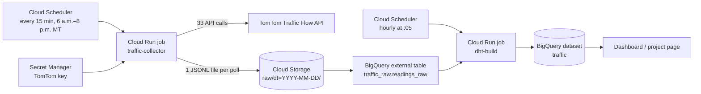
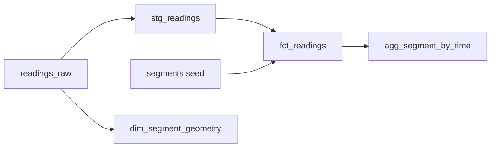

# Provo–Eagle Mountain Commute Traffic Pipeline

A cloud data pipeline that measures live traffic speeds along my daily commute between Provo and Eagle Mountain, Utah, every 15 minutes, and turns the readings into tested tables that answer one question:

> **When should I leave, and which part of the drive causes the delay?**

Built for CS 452 on Google Cloud. It runs on its own schedule without my laptop.
[Public Dashboard](https://claude.ai/artifact/PGgma3YVHkNrUFtYAhTzvv)

---

## Contents

- [What it found](#what-it-found)
- [Architecture](#architecture)
- [Technologies](#technologies)
- [Project structure](#project-structure)
- [Data model](#data-model)
- [Table schemas](#table-schemas)
- [Data quality tests](#data-quality-tests)
- [Design decisions](#design-decisions)
- [Setup and deployment](#setup-and-deployment)
- [Operating the pipeline](#operating-the-pipeline)
- [Limitations](#limitations)
- [Future work](#future-work)

---

## What it found

Results from the first full day of collection (Thursday, November 12, 2026, 6:00 a.m.–3:15 p.m., 33 segments):

| Finding | Result |
|---|---|
| Worst departure toward Eagle Mountain | 8:30 a.m., about 13 extra minutes over free flow |
| Worst departure toward Provo | 8:00–8:30 a.m., about 11 extra minutes |
| Best morning window toward Eagle Mountain | 6:00–6:30 a.m., about 1 extra minute |
| Slowest segment | I-15 northbound, about 12 mph vs. 71 mph free flow, 8:15–9:00 a.m. |
| Afternoon pattern | The trip toward Eagle Mountain starts slowing after 2:00 p.m. |

These come from a single day, so they're early patterns rather than reliable averages. "Extra minutes" is estimated by walking the route segment by segment and using each segment's delay at the time you would reach it.

---

## Architecture



**How a poll works**

1. **Cloud Scheduler** triggers the `traffic-collector` Cloud Run job every 15 minutes from 6:00 a.m. to 7:45 p.m. Mountain Time.
2. The job runs a Docker container with the Python collector, as the `traffic-collector` service account. The TomTom API key comes from **Secret Manager**.
3. The collector reads `segments.csv`, calls the **TomTom Flow Segment Data API** once per active segment, and records one timestamp for the whole poll.
4. It writes one **JSONL** file per poll and uploads it to **Cloud Storage** under a date folder (`raw/dt=2026-11-12/20261112T1430Z.jsonl`).
5. **BigQuery** reads those files through an external table, `traffic_raw.readings_raw`, with no load step.
6. A second Cloud Run job runs **`dbt build`** hourly at 5 past the hour, rebuilding the clean tables and running every data test.

This is an **ELT** pipeline: extract and load happen in Python, and all transformation happens in SQL inside the warehouse.

---

## Technologies

| Layer | Technology | Role |
|---|---|---|
| Source | TomTom Traffic Flow API | Live speed, free-flow speed, travel time, and confidence per road segment |
| Scheduling | Cloud Scheduler | Triggers the collector (every 15 min) and dbt (hourly) |
| Compute | Cloud Run jobs | Runs each container on demand, then shuts down |
| Packaging | Docker, Cloud Build, Artifact Registry | Builds and stores the container images |
| Secrets | Secret Manager | Stores the TomTom API key outside the code |
| Raw storage | Cloud Storage | Keeps every original API response as JSONL |
| Warehouse | BigQuery | Queries the raw files and stores the clean tables |
| Transformation | dbt Core + `dbt-bigquery`, `dbt_utils` | SQL models, seeds, and data tests |
| Identity | IAM service accounts | Separate, least-privilege identities per job |
| Language | Python 3.12 in the cloud (`requests`, `google-cloud-storage`) | The collector |
| Presentation | HTML project page, Data Studio | Map, heatmap, and departure-time charts |

---

## Project structure

```
MA-Commute-Traffic/
├── collector/
│   ├── main.py                  # Polls TomTom, writes JSONL, uploads to Cloud Storage
│   └── segments.csv             # Segment list (source of truth for the collector)
├── tools/
│   └── check_segments.py        # Checks new points: duplicates, gaps, and a GeoJSON map
├── traffic_dbt/
│   ├── dbt_project.yml          # Materializations and seed column types
│   ├── profiles.yml             # BigQuery connection used by the cloud dbt job
│   ├── packages.yml             # dbt_utils
│   ├── Dockerfile               # Image for the dbt-build Cloud Run job
│   ├── .dockerignore
│   ├── seeds/
│   │   └── segments.csv         # Copy of collector/segments.csv, loaded as a table
│   ├── models/
│   │   ├── staging/
│   │   │   ├── sources.yml      # Declares traffic_raw.readings_raw
│   │   │   └── stg_readings.sql
│   │   └── marts/
│   │       ├── schema.yml       # Column tests
│   │       ├── fct_readings.sql
│   │       ├── agg_segment_by_time.sql
│   │       └── dim_segment_geometry.sql
│   └── tests/
│       └── every_poll_has_all_segments.sql
├── Dockerfile                   # Image for the traffic-collector Cloud Run job
├── .dockerignore                # Keeps .env, .venv, and local data out of the image
├── requirements.txt
├── .gitignore
└── README.md
```

---

## Data model

Data moves through layers, each with one job:

| Layer | Model | Materialized as | Grain | Purpose |
|---|---|---|---|---|
| Bronze | `traffic_raw.readings_raw` | External table | One JSON line per segment per poll | The raw files, never edited |
| Staging | `stg_readings` | View | Same as raw | Flatten nested fields, rename to snake_case with units, add Mountain Time |
| Seed | `segments` | Table | One row per segment | Route order, trip, coordinates, active dates |
| Silver | `fct_readings` | Table, partitioned and clustered | One row per segment per poll | Deduplicate, join segment details, add time fields and congestion ratio |
| Dimension | `dim_segment_geometry` | Table | One row per segment | The road shape TomTom measured, as a line |
| Gold | `agg_segment_by_time` | Table | One row per segment × weekday × 15-minute slot | Averages used by the dashboard |



`dim_segment_geometry` reads from the raw source rather than staging, because staging deliberately drops the coordinate list so it isn't repeated in every reading.

---

## Table schemas

### `traffic_raw.readings_raw` (external table)

Reads `gs://commute-traffic-raw-ma/raw/*` as newline-delimited JSON, with Hive partitioning on the `dt=` folder.

| Column | Type | Description |
|---|---|---|
| `segment_id` | STRING | My ID for the segment, from `segments.csv` |
| `collected_at` | TIMESTAMP | When the poll ran, in UTC; shared by every row in the poll |
| `response` | STRUCT | TomTom's `flowSegmentData`, or `NULL` if the call failed |
| `response.frc` | STRING | Road class (FRC0 = freeway, higher = smaller road) |
| `response.currentSpeed` | INT64 | Current average speed (mph) |
| `response.freeFlowSpeed` | INT64 | Typical speed with no traffic (mph) |
| `response.currentTravelTime` | INT64 | Seconds to drive the segment now |
| `response.freeFlowTravelTime` | INT64 | Seconds with no traffic |
| `response.confidence` | FLOAT64 | 0–1; how much live data supports the reading |
| `response.roadClosure` | BOOL | Whether the segment is closed |
| `response.coordinates.coordinate` | ARRAY<STRUCT<latitude, longitude>> | The segment's shape |
| `error` | STRING | Error message if the API call failed, otherwise `NULL` |
| `dt` | DATE | Partition column from the folder name (UTC date) |

### `traffic.stg_readings` (view)

| Column | Type | Description |
|---|---|---|
| `segment_id` | STRING | Segment ID |
| `collected_at` | TIMESTAMP | Poll time, UTC |
| `collected_at_mt` | DATETIME | Poll time, Mountain Time |
| `current_speed_mph` | INT64 | Current speed |
| `free_flow_speed_mph` | INT64 | Free-flow speed |
| `current_travel_time_s` | INT64 | Current travel time, seconds |
| `free_flow_travel_time_s` | INT64 | Free-flow travel time, seconds |
| `confidence` | FLOAT64 | 0–1 |
| `road_closure` | BOOL | Road closed |
| `frc` | STRING | Road class |
| `error` | STRING | Error message, if any |
| `is_error` | BOOL | `TRUE` when the API call failed |

### `traffic.segments` (seed)

| Column | Type | Description |
|---|---|---|
| `segment_id` | STRING | Primary key, e.g. `i15_nb_06` |
| `trip` | STRING | `to_em` (to Eagle Mountain) or `to_provo` |
| `road` | STRING | Road name |
| `direction` | STRING | `NB`, `SB`, `EB`, or `WB` |
| `seq` | INT64 | Order along the trip, starting at 1 |
| `lat`, `lon` | FLOAT64 | The point used to look up the segment |
| `active_from` | DATE | First day the segment is polled |
| `active_to` | DATE | Last day it was polled; `NULL` if still active |

### `traffic.fct_readings` (table)

Partitioned by `collected_date_mt`, clustered by `segment_id`. Includes error rows, flagged with `is_error`.

| Column | Type | Description |
|---|---|---|
| *all `stg_readings` columns* | | See above |
| `road`, `direction`, `seq`, `trip` | | Joined from `segments` |
| `poll_slot_mt` | DATETIME | Poll time rounded down to its 15-minute slot, Mountain Time |
| `collected_date_mt` | DATE | Date in Mountain Time (partition column) |
| `hour_mt` | INT64 | Hour in Mountain Time, 0–23 |
| `day_of_week` | STRING | e.g. `Thursday` |
| `congestion_ratio` | FLOAT64 | `current_speed_mph / free_flow_speed_mph`; 1.0 means free flow |

`poll_slot_mt` exists because Cloud Run takes a minute or so to start, so a 6:00 poll may be stamped 6:01:32. Rounding to the slot lines up readings across days.

### `traffic.agg_segment_by_time` (table)

Excludes error rows, readings with `confidence < 0.6`, and readings outside 6:00 a.m.–7:59 p.m.

| Column | Type | Description |
|---|---|---|
| `segment_id`, `road`, `direction`, `seq`, `trip` | | Segment details |
| `day_of_week` | STRING | Weekday |
| `time_slot` | TIME | 15-minute slot, e.g. `08:30:00` |
| `n_readings` | INT64 | Readings averaged; shows how reliable each row is |
| `avg_speed_mph` | FLOAT64 | Average current speed |
| `avg_free_flow_mph` | FLOAT64 | Average free-flow speed |
| `avg_congestion_ratio` | FLOAT64 | Average congestion ratio |
| `avg_delay_s` | FLOAT64 | Average extra seconds over free flow |

### `traffic.dim_segment_geometry` (table)

| Column | Type | Description |
|---|---|---|
| `segment_id` | STRING | Segment ID |
| `segment_line` | GEOGRAPHY | The segment's shape as a line, from its most recent successful reading |

---

## Data quality tests

`dbt build` runs these after building each model. A failing test stops downstream models from building.

| Test | Model | What it protects against |
|---|---|---|
| `unique_combination_of_columns` on `segment_id` + `collected_at` | `fct_readings` | Duplicate readings, e.g. a file uploaded twice |
| `not_null` on `segment_id`, `collected_at` | `fct_readings` | Rows that can't be identified |
| `relationships` to `segments.segment_id` | `fct_readings` | Readings for a segment missing from the segment list |
| `accepted_range` 0–100 on `current_speed_mph` (non-error rows) | `fct_readings` | Impossible speeds |
| `accepted_range` 0–1 on `confidence` (non-error rows) | `fct_readings` | Malformed confidence values |
| `accepted_values` NB/SB/EB/WB on `direction` | `fct_readings` | Typos in the segment list |
| `every_poll_has_all_segments` (custom) | `fct_readings` | A poll missing segments. Each poll must have exactly the segments active on its date, using `active_from` and `active_to`. |

---

## Design decisions

- **ELT, raw data kept.** The collector saves TomTom's full response. Choosing columns happens in dbt, so any bug can be fixed and the full history reprocessed.
- **Failures are recorded as rows.** A failed API call is saved with `response = NULL` and an `error` message. A gap in the data therefore always means the job didn't run, and the completeness test can tell a missing segment apart from a failed call.
- **One timestamp per poll.** Every reading in a poll shares `collected_at`, so the file name and its rows always match and polls group cleanly.
- **External table for the raw layer.** New files appear in BigQuery automatically with no load step. dbt materializes the layers above it as real tables for speed.
- **UTC stored, Mountain Time analyzed.** Timestamps are stored in UTC and converted in staging, so daylight saving changes don't shift the patterns.
- **Partitioning and clustering.** `fct_readings` is partitioned by date and clustered by segment so queries scan only what they need.
- **Least-privilege identities.** The collector can only read one secret and create files in one bucket; it can't delete or overwrite them. The dbt job has its own service account with BigQuery and read-only bucket access.
- **Configuration through the environment.** The API key, bucket name, and output folder come from environment variables, so the same code runs on a laptop (`.env`) and in Cloud Run (Secret Manager and job settings).
- **Segments change over time.** `active_from` and `active_to` let the route grow from 5 test segments to 33 without rewriting history or breaking tests. Retired segments are kept, never deleted, because past readings reference them.
- **Polling window sized to the API budget.** 33 segments × 56 polls a day = 1,848 calls, under TomTom's free daily limit of 2,500 non-tile requests.

---

## Setup and deployment

### Prerequisites

- A Google Cloud project with billing enabled and the Google Cloud CLI installed
- A TomTom developer API key
- Python 3.12 recommended

### 1. Enable services and create storage

```bash
gcloud services enable run.googleapis.com cloudscheduler.googleapis.com bigquery.googleapis.com storage.googleapis.com secretmanager.googleapis.com cloudbuild.googleapis.com artifactregistry.googleapis.com

gcloud storage buckets create gs://commute-traffic-raw-ma --location=us-central1
bq mk --location=us-central1 traffic_raw
```

Keep every resource in `us-central1`. BigQuery can only query datasets in the same location as the job.

### 2. Run the collector locally

Create `.env` in the project root (it's in `.gitignore`):

```
TOMTOM_KEY=your-key
GCS_BUCKET=commute-traffic-raw-ma
```

```bash
python -m venv .venv
source .venv/bin/activate        # Windows: .venv\Scripts\activate
pip install -r requirements.txt
gcloud auth application-default login
python collector/main.py
```

Before adding segments, run `python tools/check_segments.py` and drag the resulting `segments_check.geojson` onto geojson.io to confirm each point matched the right road.

### 3. Store the key and create the service account

Create a secret named `tomtom-key` in Secret Manager, then:

```bash
PROJECT=ma-commute-traffic-analysis
SA=traffic-collector@$PROJECT.iam.gserviceaccount.com

gcloud iam service-accounts create traffic-collector
gcloud secrets add-iam-policy-binding tomtom-key --member="serviceAccount:$SA" --role="roles/secretmanager.secretAccessor"
gcloud storage buckets add-iam-policy-binding gs://commute-traffic-raw-ma --member="serviceAccount:$SA" --role="roles/storage.objectCreator"
```

### 4. Deploy and schedule the collector

```bash
gcloud run jobs deploy traffic-collector --source . --region us-central1 \
  --service-account $SA --set-secrets TOMTOM_KEY=tomtom-key:latest \
  --set-env-vars "GCS_BUCKET=commute-traffic-raw-ma,OUTPUT_DIR=/tmp" \
  --max-retries 1 --task-timeout 120s

gcloud run jobs add-iam-policy-binding traffic-collector --region us-central1 \
  --member="serviceAccount:$SA" --role="roles/run.invoker"

gcloud scheduler jobs create http traffic-collector-schedule --location us-central1 \
  --schedule "*/15 6-19 * * *" --time-zone "America/Denver" \
  --uri "https://run.googleapis.com/v2/projects/$PROJECT/locations/us-central1/jobs/traffic-collector:run" \
  --http-method POST --oauth-service-account-email $SA
```

On Windows PowerShell, put each command on one line and quote values containing commas.

### 5. Create the external table

Run in the BigQuery console:

```sql
CREATE OR REPLACE EXTERNAL TABLE `traffic_raw.readings_raw` (
  segment_id STRING,
  collected_at TIMESTAMP,
  response STRUCT<
    frc STRING, currentSpeed INT64, freeFlowSpeed INT64,
    currentTravelTime INT64, freeFlowTravelTime INT64,
    confidence FLOAT64, roadClosure BOOL,
    coordinates STRUCT<coordinate ARRAY<STRUCT<latitude FLOAT64, longitude FLOAT64>>>
  >,
  error STRING
)
WITH PARTITION COLUMNS (dt DATE)
OPTIONS (
  format = 'NEWLINE_DELIMITED_JSON',
  uris = ['gs://commute-traffic-raw-ma/raw/*'],
  hive_partition_uri_prefix = 'gs://commute-traffic-raw-ma/raw',
  ignore_unknown_values = true
);
```

### 6. Run dbt

```bash
cd traffic_dbt
dbt deps
dbt seed
dbt build
```

### 7. Deploy and schedule dbt

```bash
DBT_SA=dbt-runner@$PROJECT.iam.gserviceaccount.com
gcloud iam service-accounts create dbt-runner
gcloud projects add-iam-policy-binding $PROJECT --member="serviceAccount:$DBT_SA" --role="roles/bigquery.jobUser"
gcloud projects add-iam-policy-binding $PROJECT --member="serviceAccount:$DBT_SA" --role="roles/bigquery.dataEditor"
gcloud storage buckets add-iam-policy-binding gs://commute-traffic-raw-ma --member="serviceAccount:$DBT_SA" --role="roles/storage.objectViewer"

gcloud run jobs deploy dbt-build --source . --region us-central1 \
  --service-account $DBT_SA --memory 1Gi --task-timeout 600s --max-retries 0

gcloud run jobs add-iam-policy-binding dbt-build --region us-central1 \
  --member="serviceAccount:$DBT_SA" --role="roles/run.invoker"

gcloud scheduler jobs create http dbt-build-schedule --location us-central1 \
  --schedule "5 6-20 * * *" --time-zone "America/Denver" \
  --uri "https://run.googleapis.com/v2/projects/$PROJECT/locations/us-central1/jobs/dbt-build:run" \
  --http-method POST --oauth-service-account-email $DBT_SA
```

The dbt job reads the bucket because querying an external table uses the caller's permissions on the underlying files.

---

## Operating the pipeline

**Check that polls are arriving**

```bash
gcloud storage ls gs://commute-traffic-raw-ma/raw/dt=2026-11-12/
gcloud run jobs executions list --job traffic-collector --region us-central1
```

**Read a job's errors:** Cloud Run → Jobs → the job → latest execution → Logs.

**Change the segment list**

1. Edit `collector/segments.csv`, setting `active_from` for new rows and `active_to` for retired ones. Never delete a row that has collected data.
2. Run `tools/check_segments.py` and confirm there are no warnings.
3. Copy the file to `traffic_dbt/seeds/segments.csv`.
4. Redeploy both jobs after 8 p.m., so the change starts with the next morning's first poll.

Each Cloud Run job runs the files baked into its image, so a change only reaches the cloud through a new deploy.

---

## Limitations

- **Limited history.** Results so far come from about one day of 33-segment data. Averages become meaningful after a few weeks.
- **TomTom sets the segment length.** Some segments extend well past the route (the Redwood Road segment is about 10 km), so their speeds cover road I don't drive, and minute estimates run high.
- **Undivided roads measure one direction.** On Redwood Road, Lehi-Fairfield Road, and part of Pony Express Parkway, TomTom returned the outbound segment no matter which side the point was on, so the trip toward Provo has no data there.
- **Two copies of the segment list.** The collector and the dbt seed each have a copy, which must be kept in sync by hand.
- **Broad dbt permissions.** `dbt-runner` has `bigquery.dataEditor` across the whole project.
- **Older local stack.** Locally, dbt 1.10 runs on Python 3.9. The cloud images use Python 3.12.

---

## Future work

- Keep collecting and compare weekdays, weather, and the effect of road construction
- Turn the departure-time estimate into its own dbt model
- Keep a single copy of the segment list (e.g. the collector reads it from Cloud Storage)
- Narrow dbt's permissions to the `traffic` and `traffic_raw` datasets
- Add an alert when a scheduled run fails or a test fails
- Upgrade local Python to 3.12 and dbt to the current release
